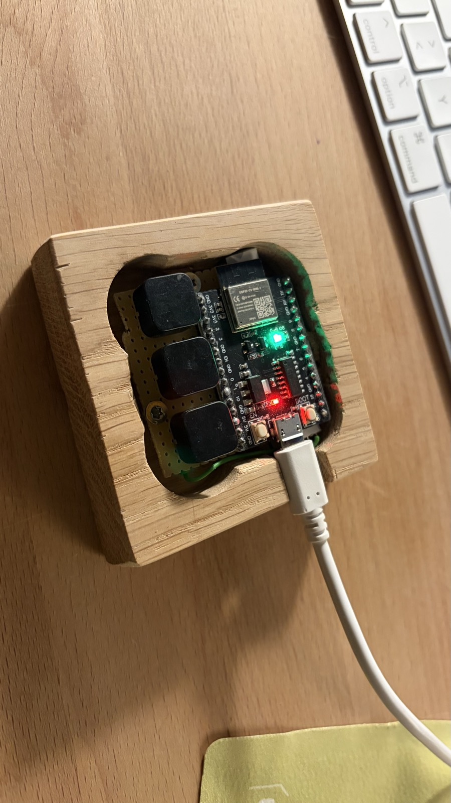
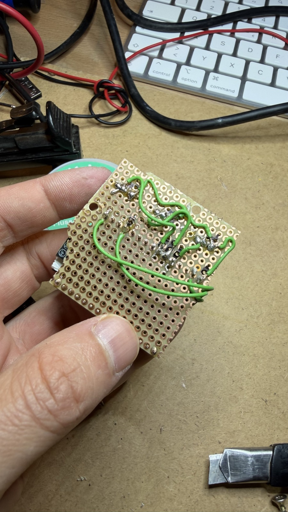
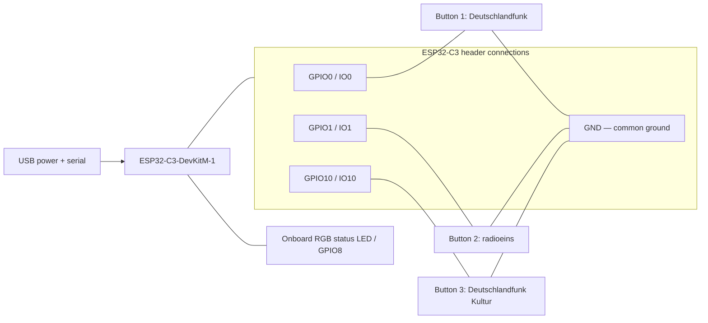

# Sonos Three Button Remote

An ESP32-C3 remote that starts one of three radio stations on a Sonos speaker.
Three physical buttons select stations; the onboard RGB LED shows connectivity
and breathes green while radio is playing. The Sonos speaker fetches the audio;
the ESP32 only sends local network commands. No display or cloud account is
required. Licensed under the [MIT license](LICENSE).

| Assembled remote | Perfboard wiring |
| --- | --- |
|  |  |

## Hardware and wiring

Tested board: **ESP32-C3-DevKitM-1**. Use three normally-open momentary buttons
and power the board through USB. The onboard RGB LED on GPIO8 provides status
indication without additional wiring.



| Connection | Board pin | Notes |
| --- | --- | --- |
| Button 1 | GPIO0 ↔ GND | First station in configuration |
| Button 2 | GPIO1 ↔ GND | Second station |
| Button 3 | GPIO10 ↔ GND | Third station |

Each button uses an internal pull-up: **pressing connects its GPIO to GND**.
Briefly bridging the GPIO to GND works for testing. Contacts debounce for
20 ms. Holding a button sends one selection; release and press to select again.
Releasing does not stop playback. Buttons held at startup are ignored until
released and pressed again. No radio starts automatically at boot.
Selections made during network operations are queued in press order (up to
16; a full queue drops the oldest). Simultaneous presses use configuration order.
GPIO0, GPIO1, and GPIO10 are not boot strapping pins; BOOT is not a station button.

## Compile-time configuration

Create private configuration files before building:

```sh
cp wifi.example.toml wifi.local.toml
cp remote.example.rs remote.local.rs
```

Edit `wifi.local.toml` with your 2.4 GHz network credentials:

```toml
ssid = "your-network"
password = "your-password"
```

Edit `remote.local.rs` to set the speaker's exact room name, model, and the
three station names and URLs. It is a Rust configuration file; the build copies
it into generated source. It must contain `TARGET_NAME`, `TARGET_MODEL`, and a
`STATIONS: [Station; 3]` array, as shown in [remote.example.rs](remote.example.rs).
The model setting omits an optional `Sonos ` prefix (for example, `One SL`).
The firmware verifies the room name, model, and Sonos manufacturer before
playback, to avoid controlling another device after an IP address changes.
Only One SL has been tested; changing the model does not guarantee compatibility.

`STATIONS` entries map in order to GPIO0, GPIO1, and GPIO10:

```rust
Station {
    name: "My radio station",
    stream_url: "https://example.com/live.mp3",
}
```

Without `remote.local.rs`, builds use `remote.example.rs`. The three public
examples preserve the hardware-tested settings:

| Button | Example station | Stream URI |
| --- | --- | --- |
| 1 | Deutschlandfunk | `https://st01.sslstream.dlf.de/dlf/01/128/mp3/stream.mp3` |
| 2 | radioeins (rbb) | `x-rincon-mp3radio://dispatcher.rndfnk.com/rbb/radioeins/live/mp3/mid` |
| 3 | Deutschlandfunk Kultur | `https://st02.sslstream.dlf.de/dlf/02/128/mp3/stream.mp3` |

radioeins returned **Sonos error 714 (Illegal MIME-Type)** with the ordinary
HTTPS dispatcher URL. Using Sonos's explicit `x-rincon-mp3radio://` prefix
resolved this on hardware. Keep that prefix for this example. Other stations
may also require it; it replaces `http://` or `https://`, rather than being
prepended to them. See [SoCo's force_radio behavior](https://soco.readthedocs.io/en/latest/_modules/soco/core.html#SoCo.play_uri).
Stream references: [radioeins](https://www.radioeins.de/faqs/radioeins_live_im_netz.html),
[Deutschlandradio](https://www.deutschlandradio.de/aenderungen-internet-streaming-100.html).

Configuration is embedded in the firmware. **Rebuild and reflash after changing
Wi-Fi, speaker, or station settings.** Local files are ignored by Git.

## Build and flash

This project pins upstream **Rust 1.99.1** and targets
`riscv32imc-unknown-none-elf`. `rustup` installs the compiler, target, rustfmt,
and Clippy from `rust-toolchain.toml` when you first run Cargo. The ESP32-C3
uses the standard Rust compiler; no custom `esp` toolchain or nightly
`build-std` setup is needed. See [The Rust on ESP Book](https://docs.espressif.com/projects/rust/book/getting-started/toolchain.html).

The firmware uses `esp-hal` 1.2.2, `esp-radio` 1.0.0-beta.1, `esp-rtos` 0.4,
and smoltcp 0.14. The radio release is pinned exactly because its API is still
in beta; keep `Cargo.lock` for reproducible dependency versions. Wi-Fi uses a
100 KiB heap and the RTOS scheduler; the application continues polling its
network stack, buttons, and status LED. Station mode currently uses 802.11b/g.
The firmware explicitly sets a **15 dBm transmit-power limit** in both the
remote and discovery example. `esp-radio` defaults to only 5 dBm; the old
stack's country configuration allowed 20 dBm. The new API takes quarter-dBm
units, so the firmware passes 60 for 15 dBm. This stays below the driver's
reported authentication-problem threshold around 16 dBm on some boards.
See `TX_POWER_DBM` in [src/wifi.rs](src/wifi.rs) and the
[radio troubleshooting guidance](https://docs.espressif.com/projects/rust/esp-radio/1.0.0-beta.1/esp32c3/esp_radio/wifi/index.html#troubleshooting).
Serial reports the configured power limit and received signal strength.

Install the flasher once (the project configures it as Cargo's runner):

```sh
cargo install espflash --version 4.6.0 --locked
```

The original ESP32-WROOM-32 is not the target, and its firmware binaries cannot
be flashed to the C3.

After creating your local configuration files:

```sh
cargo build --release --locked
```

Find the board's serial port (`ls /dev/cu.*` on macOS). Replace `PORT` below
with your own port; Linux commonly uses `/dev/ttyUSB0` and Windows uses `COMn`.

First, test the buttons without network access:

```sh
cargo run --example button-test --release --locked -- --port PORT
```

The monitor reports each button by number and GPIO. Bridge its GPIO to GND,
release, and repeat. The shared build script still requires `wifi.local.toml`.

Then flash the remote:

```sh
cargo run --release --locked -- --port PORT
```

Wi-Fi association and DHCP address acquisition are separate steps. While
waiting for an address, the LED stays red and serial reports `Getting IP`.
Slow DHCP replies can take more than 20 seconds: the firmware reports
`Continuing DHCP...` and keeps the Wi-Fi connection while DHCP retries. A lost
Wi-Fi link triggers reconnection. Successful DHCP prints `Network address`.
smoltcp 0.14 includes the fix that preserves the offer's transaction ID in
DHCP requests and retries.

Wait for `Ready` / `Press for radio`, then press a station button. The monitor
reports `Starting radio...`, the selected name and URI, then `Playing radio`.
Failed playback attempts are retried up to three times after the initial
attempt, with a one-second pause and a speaker identity check before each
retry. Retries stop early if the speaker becomes unavailable. Button presses
remain queued and the LED animation continues during retries.
Errors include Sonos SOAP error codes. Serial uses UART0 at **115200 baud**,
through the board's USB-to-UART bridge (TX GPIO21, RX GPIO20).

If connecting stalls, hold BOOT, press and release RST, release BOOT, and retry.
Press RST after opening the monitor if startup output was missed. The speaker
and ESP32 must share a LAN that permits local communication and multicast.

## Status LED

The onboard RGB LED on GPIO8 shows the following states. The board's red
power LED stays on.

- **Red:** starting, Wi-Fi disconnected, or no DHCP address.
- **Orange:** Wi-Fi has an IP, but Sonos is being searched for or is unreachable.
- **Steady dim green (12/255):** Sonos is reachable, with no confirmed radio playback.
- **Breathing green:** radio is playing. Brightness rises from 1/255 to 24/255
  over three seconds and falls over three seconds, repeating.

Speaker identity is checked every 30 seconds, before playback, and after
playback errors. Playback and media state are polled every three seconds,
including changes made in another app. Animation continues during network
waits. Radio detection uses configured station URLs, Sonos radio URI schemes,
or broadcast metadata. Unrecognized sources or grouped playback through a
different coordinator may not be detected. A playback rejection alone does
not mean the speaker is unreachable; details go to serial. The LED reports
local network connectivity, not Internet access. Examples do not drive the LED.

## Examples and tests

Standalone Sonos discovery (uses your compiled speaker settings):

```sh
cargo run --example sonos-discovery --release --locked -- --port PORT
```

Discover speakers from the Mac on the same LAN, without third-party Python packages:

```sh
python3 scripts/discover_sonos.py --name "Your speaker room name"
```

This uses SSDP and falls back to checking port 1400 on the active LAN subnet.
Use `--interface` and `--subnet` to override automatic interface selection.

Run host tests without a board (always use public example settings). Override
the firmware target with your computer's Rust host target:

```sh
cargo test -p sonos-network-tests --locked --target "$(rustc -vV | sed -n 's/^host: //p')"
```

The DHCP regression test simulates delayed offers and acknowledgements beyond
20 seconds, checks that requests and retries retain the offer's transaction
ID, and verifies that resetting DHCP after link loss clears the old address. It uses the
same network module and smoltcp dependency as the firmware.

The migrated firmware has been flashed and verified on the ESP32-C3-DevKitM-1
with Rust 1.99.1 and espflash 4.6.0. Early startup tests passed, but subsequent
use exposed intermittent Wi-Fi and Sonos-discovery failures. The explicit
15 dBm transmit-power setting addresses a concrete difference from the old
stack. With this setting, three starts obtained an address and reached `Ready`,
and all three station selections reached `Playing radio`. One selection
needed a playback retry. These checks do not establish long-term reliability;
reconnection after restarting the access point has not been rechecked.

The last pre-migration revision is `b3c9597`, using the legacy `esp` toolchain
and pinned dependencies. It remains the rollback point if the current stack
continues to be unreliable in everyday use.

All 16 host tests pass, covering DHCP, Sonos parsing, button logic, and LED
frame generation. Both examples and the remote build in debug and release profiles;
formatting, Clippy, and ESP32-C3 image generation checks pass.

Check all firmware builds and formatting without flashing:

```sh
cargo build --release --locked --bins --examples
cargo build --locked --bins --examples
cargo fmt --all -- --check
cargo clippy --release --locked --bins --examples -- -D warnings
```

MIT applies to this project's source. Dependencies retain their own licenses,
including Espressif's Wi-Fi components. This is an independent project and is
not affiliated with Sonos or the example broadcasters.
